# Ship Happens

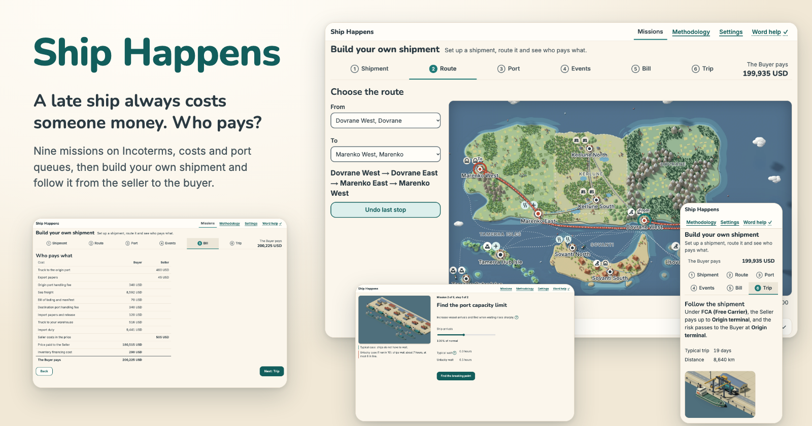

> This repository is a showcase: the README, the screenshots and the licence. The source code lives in a private repository.

## Play it

**[shiphappens.nadya-pribadi.workers.dev](https://shiphappens.nadya-pribadi.workers.dev)**

Free, no account, nothing to install. It works on a phone or a laptop.

It does not open? Some Indonesian internet providers block <code>workers.dev</code> addresses.

 

The block happens when your provider looks the address up, not in the game itself. Looking it up with another DNS service fixes it. Any one of these works:

- **Chrome, Edge, Brave:** open Settings, search for "secure DNS", turn it on and choose Cloudflare (1.1.1.1) or Google.
- **Firefox:** open Settings, search for "DNS over HTTPS", choose Increased Protection and pick Cloudflare.
- **Android:** Settings, Network, Private DNS, choose the provider hostname option and enter `one.one.one.one`.
- **iPhone, iPad or Mac:** in the Wi-Fi settings, set DNS to `1.1.1.1` and `1.0.0.1`. This covers Wi-Fi only.
- **Any phone or laptop, also on mobile data:** install the free 1.1.1.1 app from Cloudflare, or use a VPN.

Then reload the page. A custom address is planned (`shiphappens.my.id`), which should avoid the problem.

**A late ship always costs someone money. The interesting question is who pays — and whether anyone in the room can show their working.**

Every delay gets argued over: the seller points at the buyer, the buyer points at the carrier, the carrier points at the schedule, and in the end somebody pays an invoice that already went out. The rules that decide it are short. Their consequences are not.

## The gap this fills

Freight teams learn who-pays the hard way — on a live shipment, after the argument, with the invoice already raised. There is no cheap place to rehearse the decision first, and nowhere to put two rules side by side and notice that the same delay produces two different bills.

That comparison is what this project makes visible.

## What it is

A browser game. You set the handover rule, delay the ship, and watch where the cost lands.

- **One link, no install, no account.** It opens in a browser and asks nothing of the visitor.
- **Useful within two minutes.** A first session is one short mission; nothing has to be read first.
- **Depth on request.** Missions start from one rule or one port queue and grow into a whole shipment, then into routes across a network and different countries. Each mission stands on its own.
- **The hook is the comparison.** Run the same disruption twice under two different rules and the two bills differ. That difference is the lesson.

The three questions it turns into decisions:

- **Who pays** when a ship is late — which costs sit with the seller and which with the buyer.
- **Who carries the risk** — at what moment it moves, and what insurance does not cover.
- **When a queue stops being a queue** — where normal congestion turns into gridlock, and which route survives it.

## A look inside

### Nine missions

Each mission is one question, a few steps and a picture of where the shipment is. The list shows the order and what each mission is about.

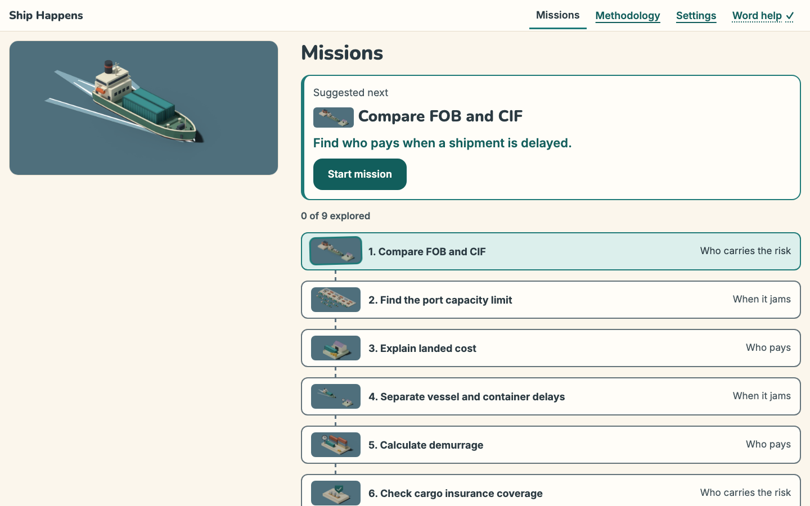

*The missions, in the order they build on each other.*

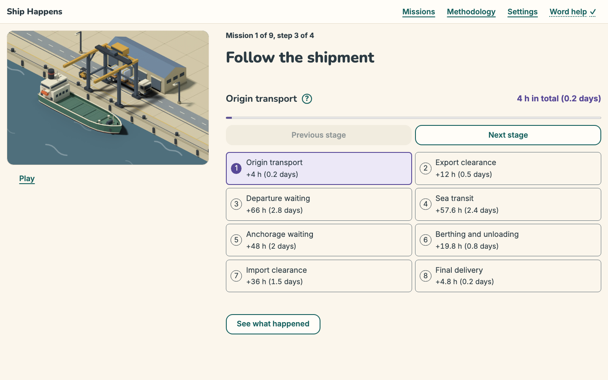

*Mission 1: follow the shipment from the origin to the final delivery, one stage at a time.*

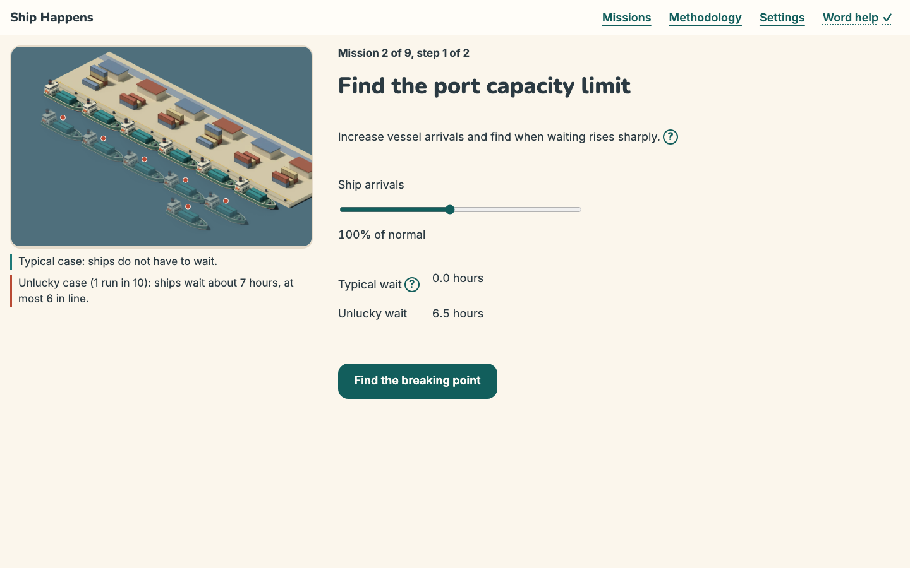

*Mission 2: push the arrivals up and find where the wait stops being a queue.*

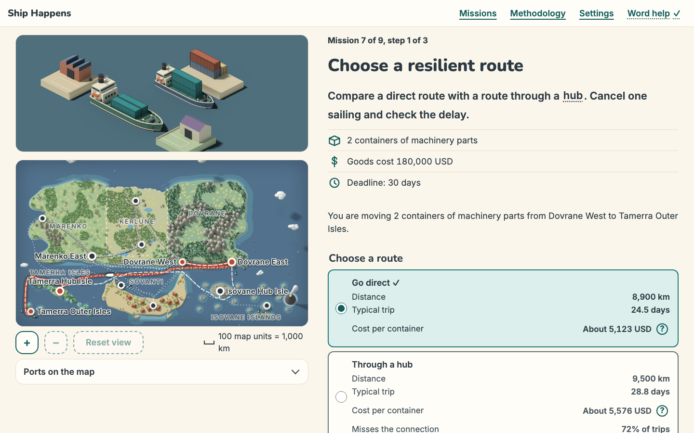

*Mission 7: a direct route against a route through a hub, with the cost and the chance of missing the connection.*

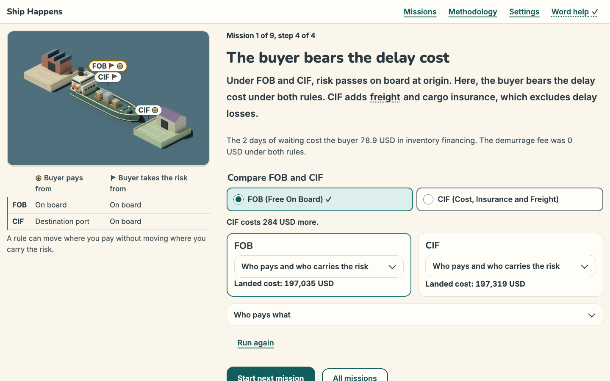

*The handover rule as a picture: where the buyer starts to pay, and where the risk moves.*

### Build your own shipment

After the missions, the same engine opens up. You choose the goods, route them on the map, set the port, add what goes wrong, and read the bill. The total on the right of the tab row follows every change.

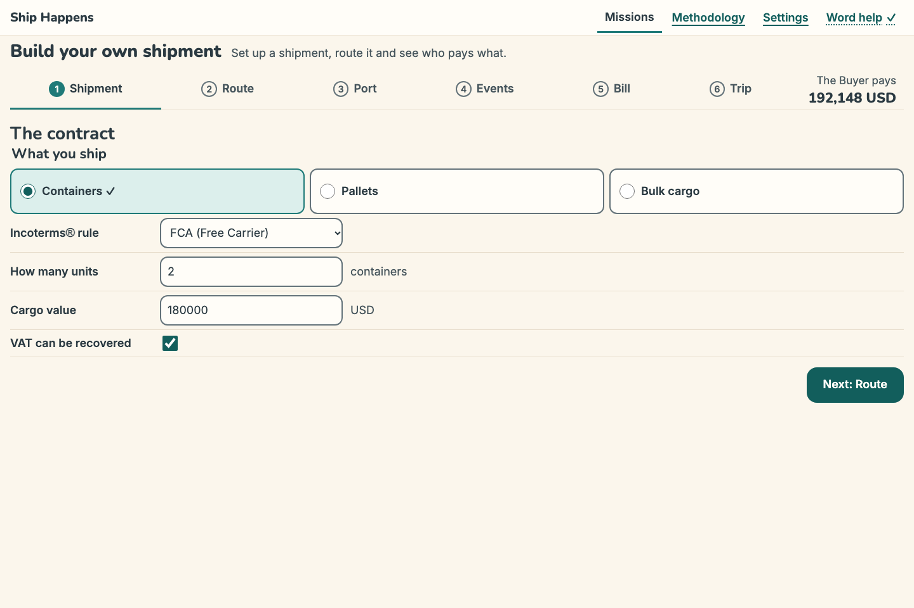

*1. Shipment: the goods and the handover rule.*

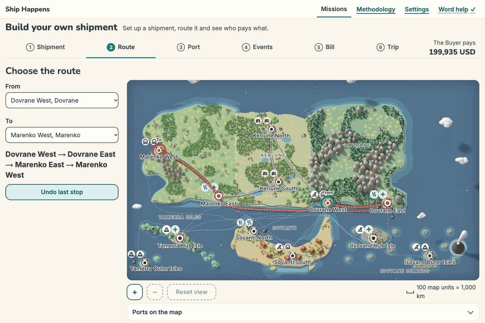

*2. Route: pick From and To. If there is no direct lane, add the stops in between from the lanes that exist for that cargo.*

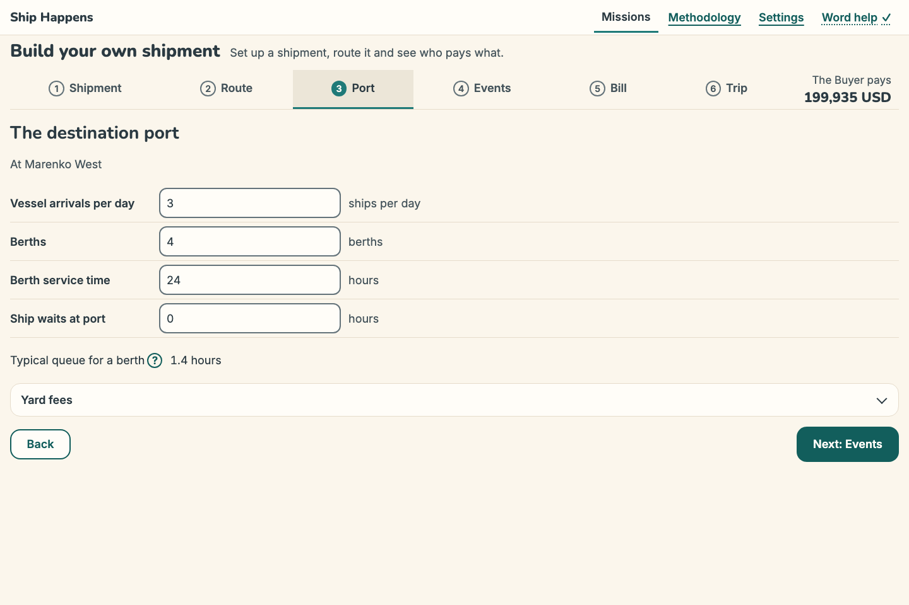

*3. Port: the berths, the arrivals and the typical queue at the destination.*

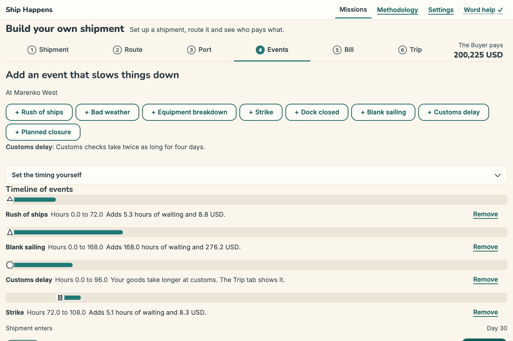

*4. Events: add a strike, bad weather or a customs delay and see what each one adds in hours and money.*

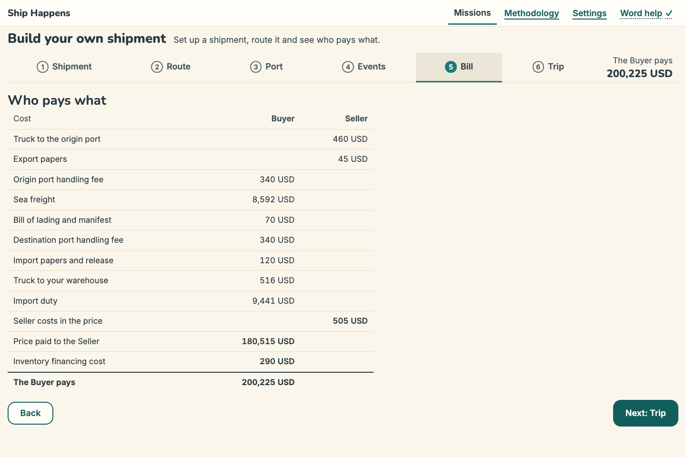

*5. Bill: every cost in the column of the side that pays it under the rule, and one total.*

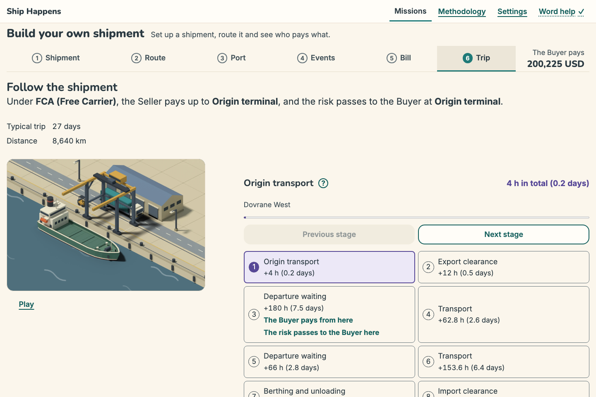

*6. Trip: the shipment stage by stage, with the delay of the port and the events, and the point where the costs and the risk pass to the buyer.*

### On a phone

The same screens work on a phone, with the picture and the choices stacked.

  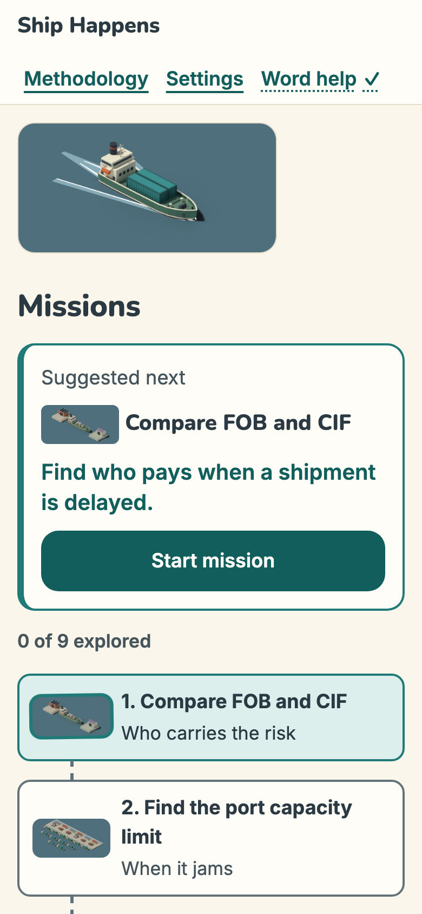
  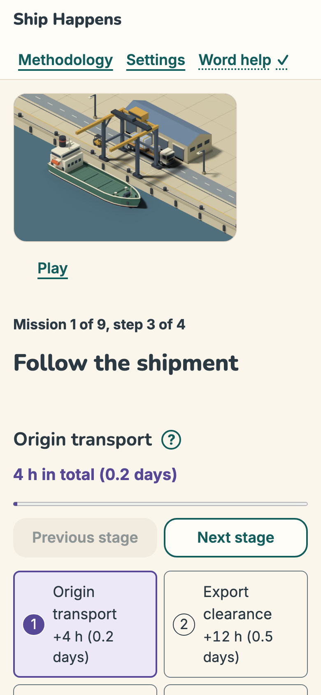
  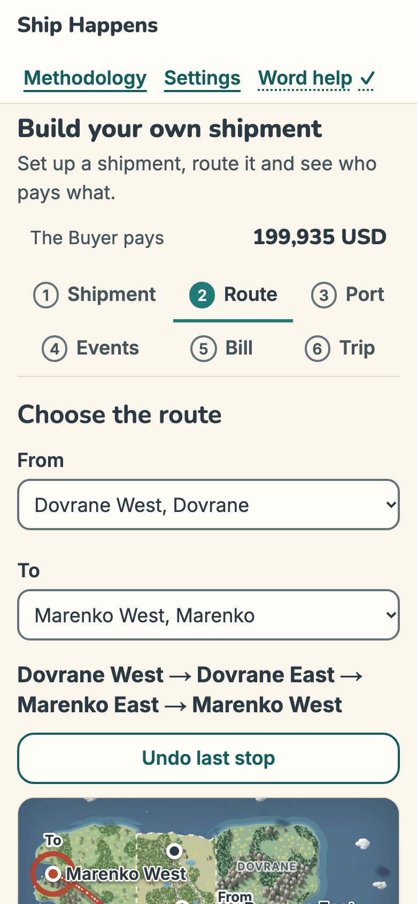
  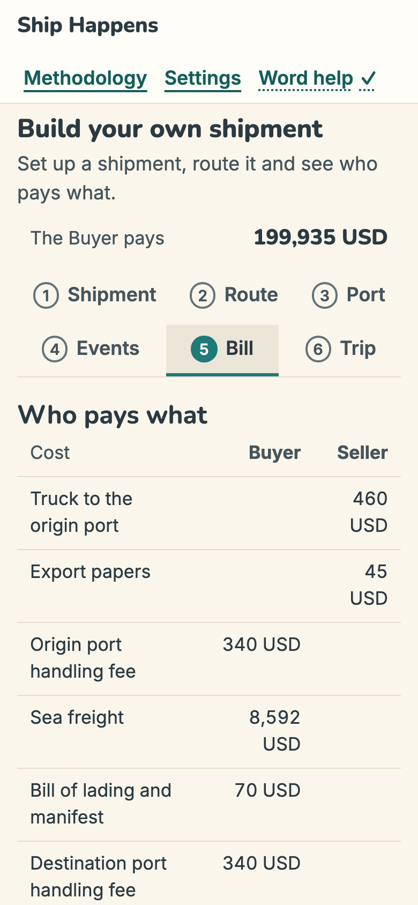
  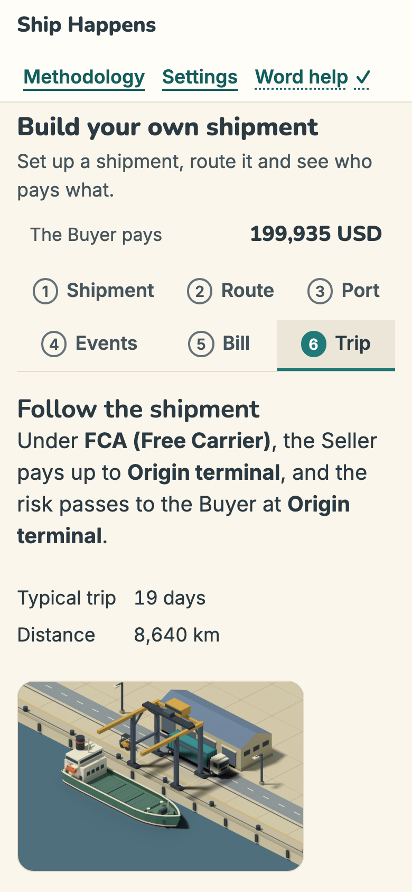

### Show your working

Every figure can be opened to see how it was worked out, and the Methodology page says what is real, what is made up and which checks run.

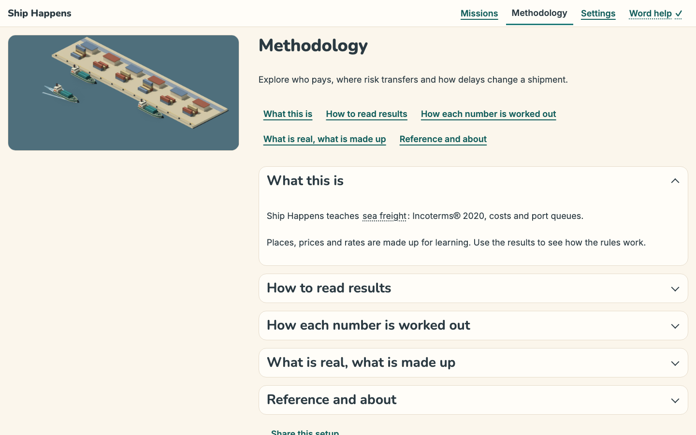

## Why a game, and not a model or a dashboard

Because the mistake people make is in the decision, not in the arithmetic. A tool that prints an answer teaches nothing about the trade-off behind it; making the call yourself and then seeing the cost attached is what stays. It is also why there is no score and no leaderboard — comparing two choices is the point, not winning.

## Who it is for

- Supply chain and logistics professionals who negotiate these terms or live with them.
- Business, procurement, and planning stakeholders who sign off on a term with no easy way to see the cost consequence.
- Students and career changers who want to understand how a one-week delay turns into a fight over real money.

## How it is being built

The build runs on the same discipline as an enterprise rollout, just smaller:

- **The specification is finished before the code starts, and then frozen.** Later requests enter a decision log with a stated reason, instead of quietly changing scope mid-flight.
- **Delivery is staged, and every stage has a measurable exit.** A stage closes on numbers or tests, not on someone judging that it feels done.
- **Each requirement has one owning document and a tracked status**, so nothing is defined in two places that can drift apart.
- **Decisions and risks are logged**, with each risk tied to the stage that closes it.
- **Verification is independent of the build.** Rule tables get checked against the official texts, and results against established queueing theory rather than against the model's own opinion.
- **Work is sized and capped**, so a stage cannot quietly expand into an unbounded project.

## Built with

- A small [Preact](https://preactjs.com) and [Vite](https://vite.dev) app that runs in the browser, served from [Cloudflare Workers](https://workers.cloudflare.com).
- A queue simulation that runs in a Web Worker. The same seed always gives the same result.
- Pictures rendered in [Blender](https://www.blender.org) from models built in code. No image model and no third-party artwork is used.
- Checks that run on every change: types, copy rules, unit and screen tests, accessibility checks, and a cross-browser check of the arithmetic in Chromium, Firefox and WebKit.

## What it deliberately is not

- **Not a prediction tool.** Every number is illustrative and author-chosen, not measured from live trade.
- **Not about real ports.** The map, countries, and port names are fictional; nothing here describes a specific real terminal.
- **Not scored.** No winning, no losing, no leaderboard.
- **Not advice.** Not legal or tax advice, and not a substitute for the official rule texts.
- **Not affiliated** with any standards body. Rule names are neutral, and the descriptions are written in the author's own words.

## Privacy

No accounts, no login, nothing about a visitor stored on a server. The only thing sent is anonymous event counts.

## Where it stands

The browser game is built and live. It has nine missions and a build-your-own-shipment mode with a route planner, events, a bill and a trip.

Human domain review, owner acceptance and real-device checks are still open. The planned public address is `shiphappens.my.id`.

## Licence

All rights reserved. This is not open source: the code, the pictures, the texts and the data may not be copied, redistributed, modified or used commercially without written permission. See [LICENSE](LICENSE).

## Behind this

Built by a practitioner who has spent their working life between logistics operations and enterprise system delivery — the same territory these questions come from.

[Nadya on LinkedIn](https://www.linkedin.com/in/nadya-nadya-404309104/)
